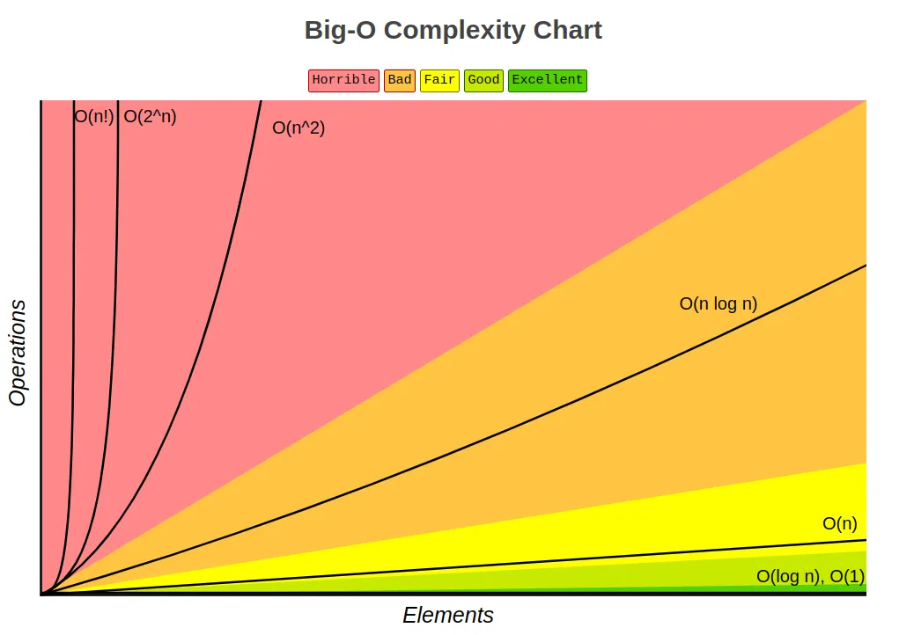

In the realm of computer science, there are numerous ways to analyze how good a code is based on different principles such as efficiency, readability, modularity, organization, etc. When focusing on algorithm efficiency/performance specifically, one common misconception is that speed would be the right way to measure it i.e. how long the algorithm takes to accomplish its task. It's obvious, isn't it? The code which runs in fewer time is surely the best one. Well, not quite.

## 1. Why not execution time?

There are lot of external factors involved in the process of running code on machines, which are not directly related to the algorithm itself, but can certainly interfere in its overall speed. For example, the execution time of a code will vary significantly depending on the hardware it runs on. What's efficient on one machine may not be on another. Different processors, memory, and other hardware components can have a major impact on performance. Even when running on the same hardware, the amount of resources the machine dedicates to it might vary from time to time.

Another factor is that code that runs efficiently on a small dataset may not scale well to larger datasets. Analyzing efficiency based solely on execution time for small input may not reveal performance issues that emerge when processing more extensive or complex data.

For these and other various reasons, time alone is not a reliable measure to determine an algorithm efficiency. A good approach has to evade these external factors and only be influenced by the algorithm implementation itself. Well, this is what Big O Notation is for.

## 2. The Big O Notation

Big O Notation is a mathematical concept used in computer science to describe the number of operations an algorithm will take to accomplish a certain task. Note that the aspect of time is completely irrelevant to Big O notation. The number of steps is what matters here. A "step", in this context, can be any operation the computer has to execute while running the algorithm, it can be a simple sum operation, a print statement, if comparisons, a function call, and so on. Bellow is an example of an algorithm which takes a constant number of 3 steps to execute.

```python
def calc_square_info(width, height):
  """returns the area and the perimeter of a given square"""
  area = width * height #step 1
  perimeter = 4 * width # step 2
  return area, perimeter # step 3
```

This is a pretty simple example where the number of operations are pretty clear and constant, which means that it will always have the same number of steps regardless of the input data. In most cases, however, the number of operations will vary according to the size of the input data, like in the example bellow.

```python
def print_even_numbers(arr):
    """prints all even numbers in the given array"""
    for num in arr:
        if num % 2 == 0:
           print(num)
```

In this case, the number of operations will vary according to how large the input data is, since operations will occur inside every iteration. How to know the total number of steps it will take then? This is the thing, in Big O notation you don't actually need to describe the exact number of steps the algorithm will take. Instead, you describe how the number of steps will grow according to the input size. In other words, Big O is all about the relation between the data volume and the number of steps.

In the example above, the number of steps will grow in equal proportion (linear) to the size of input data i.e. if the input data size is N the number of steps will also be around N. In Big O notation, this algorithm is said to have an efficiency of O(N). Other algorithms might grow in quadratic time i.e. if the input size is N the number of steps will be N² which in Big O notation is the efficiency of O(N²). There's also the case where the number of steps is constant, as in the first example, which is then described as O(1). One might say that it takes 3 steps so it should be O(3) instead. Just remember that growth relation is what matters, the number of steps itself is irrelevant. This means that there is no difference between a O(3) and a O(500) algorithm since both of them are constant that's only what matters, so we just describe both of them as being O(1).

As you noticed, Big O notation is always described in the same pattern: the letter O followed by the growth relation noted inside parenthesis. Usually, the letter N appears referencing the input size. For example, in quadratic time complexity, O(N²), N is the input size. This means that the growth of steps will be the number of input elements squared (multiplied by itself). For example, given an input size (N) of 4 the number of steps will be 16. That's why O(N²) is the notation.

These Big O notations describe what we call Time Complexity, which is the algorithm efficiency result. As you can imagine, there a few others besides O(N), O(N²) and O(1). Most fundamental time complexities will be explained in the following section. The important thing here is to understand how Big O Notation overcomes the problem of being influenced by the external factors mentioned previously. Also remember that we don't deal with the exact number of steps of algorithms but instead with the growth relation of steps according to the input size, which gives a much more macro and predictable view of the algorithm efficiency.

## 3. Big O Time Complexities

Time Complexity is the result of the relation between number of steps (operations) and input size (elements), which is then described using Big O notation, as seen previously. As you can imagine, we always want to avoid time complexities labeled as horrible and always aim to the most efficient as possible. This section contains explanations about the most fundamental and common time complexities, though it's also possible that other algorithms have their specific time complexities to properly describe their behavior.



### 3.1. O(1) → Constant Time

Constant time complexity simply means that the algorithm takes the same number of operations regardless of the input size. The same code might take 2 seconds in one machine and 0.00001 seconds in another machine, it does not matter, it will it still be O(1). This is the best an algorithm can get, it has excellent performance, once its execution time will not depend on the input data volume. See the example bellow, no matter the input, the number of steps always remains the same.

```python
def get_temperature(city):
    """
    Returns the current temperature of a given city.
    """
    temperature_data = service.fetch_temperatures()

    if city in temperature_data:
        return temperature_data[city]
    else:
        return "Unavailable"
```

### 3.2. O(log N) -> Logarithm Time

First things first, O(log N) is just shorthand for O(log2 N). This means that the number of steps will be log2 N, where N is the input size. For example, if the input size is 8 then the number of steps will be 3, since log2 8 = 3. To simplify the understanding, just notice that logarithm algorithms happens as if we're dividing the input size in half every time until only one element remains. For example, if the input size is 8 then dividing it in half we get 4, diving again we get 2, dividing again we get 1, this is where we stop. The total number of divisions made was 3, so 3 is the result. This is what actually happens in the algorithm, on every iteration the number of remaining iterations is reduced by half.

Logarithm time complexity is considered very efficient and is present in lots of important and highly efficient algorithms in computer science such as database searches, sorting algorithms, file systems management, and so much more. See the example bellow where a binary search is performed upon an ordered array, notice that after each iteration, the number of elements being iterated is reduced by half.

<figure>
  
  <figcaption>Available in: <a href="https://brilliant.org/wiki/binary-search/">https://brilliant.org/wiki/binary-search/</a></figcaption>
</figure>

Bellow is the implementation of the binary search in Python. It might seem a little intimidating if you're not familiar with binary search at all. What's happening is: we divide the array in half then get the middle element, if this element is greater than the value being searched, it means that the element we're searching for can only be in the left half of the divided array, this way we eliminate half of the elements after each iteration. The same logic applies in case of the middle element being less than the searched value, only switching to the right half instead. We do this until we find the value or run out of elements.

```python
def binary_search(arr, value):
    """
    Performs a binary search for the given value in the given array.
    Returns its position in the array if found. otherwise returns -1.
    """
    left_index = 0
    right_index = len(arr) - 1

    while left_index <= right_index:
        middle_index = (left_index + right_index) // 2
        middle_value = arr[middle_index]
        if middle_value == value:
            return middle_index
        elif middle_value > value:
            right_index = middle_index - 1
        else:
            left_index = middle_index + 1

    return -1
```

### 3.3. O(N) -> Linear Time

Probably the most common time complexity. Linear time means that the number of operations will grow linearly with the input size. It's represented as O(N), where N is the input size, meaning that the number of operations will grow in equal proportion to it. Note that linear time is considered relatively efficient and also very predictable as the operations grow in steady rate. See this in the example bellow.

```python
def double_numbers(arr):
    """Doubles each number in the given array"""
    for index in range(len(arr)):
        arr[index] = arr[index] * 2

    return arr
```

### 3.4. O(N log N)

O(N log N) is a time complexity that lies between linear time and quadratic time. It is slower than a linear implementation but faster than a quadratic one. In this case, if you double the size of the input, the number of operations required increases proportionally to N times the logarithm of N. This one might be a little harder to understand, but luckily it is also very rare to find. A famous example of this time complexity is the merge sort algorithm, which, for simplicity is not demonstrated here, since the code is a rather long one.

### 3.5. O(N²) -> Quadratic Time

As the name suggests for this case, as the input size increases, the number of operations will also increase quadratically. For example, if the number of input elements is 4, the number of operations will be 16, since 4² = 16. This is a rather easy to spot time complexity as it is usually associated with having nested loops in the algorithm. O(N²) is considered inefficient and can usually be optimized. See the example bellow, where a function checks for duplicate values inside an array using nested loops.

```python
def has_duplicate_values(array):
    """Checks if the given array has duplicate values"""
    for i in range(len(array)):
        for j in range(len(array)):
            if i != j and array[i] == array[j]:
                return True
    return False
```

### 3.6. O(2^N) -> Exponential Time

In exponential time complexity, as the size of the input (N) increases, the number of operations required by the algorithm grows exponentially. When an algorithm has a time complexity of O(2^N), if you increase the input size by just one, the number of operations required roughly doubles. For example, if it is given an input size of 8, the total number of operations would be around 256, since 2⁸ = 256. If we add a single element to the input, making it 9, the number of operations will double to 512, since 2⁹ = 512. This time complexity is very inefficient and almost impractical for large inputs and must be avoided at all costs. The example bellow implements the Fibonacci sequence algorithm, which is a famous representation of this time complexity.

```python
def fibonacci(n):
    """Implements the Fibonacci sequence generator"""
    if n <= 1:
        return n
    else:
        return fibonacci(n - 1) + fibonacci(n - 2)
```

### 3.7. O(N!) -> Factorial Time

Factorial time complexity means that as the size of the input (N) increases, the number of operations required by the algorithm grows factorially. In other words, when an algorithm has a time complexity of O(N!), if you increase the input size by one, the number of operations required increases by a factor of N. For example, if the input size is 4, the number of operations is 4!, which is 4 x 3 x 2 x 1 = 24; if it is = 5, it would be 5!, or 5 x 4 x 3 x 2 x 1 = 120, and so on. This is an extremely rapid growth rate, which makes it an absolutely horrible solution in terms of efficiency. Luckily though, this is also a rather rare time complexity to find. A good example of this case is the travelling salesman problem solved by a brute force approach.

## 4. Rules to define Big O notations

When defining time complexities with Big O it's important to pay attention to some of its rules so that you don't end up describing something that looks like a Big O notation but doesn't make sense in the end.

### 4.1. Always consider the worst-case scenario

With Big O notation, we can describe the best, average and worst case scenarios of each algorithm. Take a look at the linear search algorithm bellow for exemplification.

```python
def linear_search(arr, value):
    """Search for the given value in the given array using linear search"""
    for i in range(len(arr)):
        if arr[i] == value:
            return i
    return -1
```

It basically iterates through all elements of the array in order until it finds the value or runs out of elements. Based on this, we have:

- **Best Case O(1)** - The best case scenario would be if the value is encountered in the first position of the array. In this case, the algorithm would only need one step. So the best case scenario is O(1).
- **Worst Case O(N)** - The worst case scenario would be if the value is encountered in the last position of the array. In this case, the algorithm would need to loop through the entire array. So the worst case scenario is O(N), where N is the number of elements in the array.
- **Average Case O(N/2)** - We could say that the average case scenario is when the value is somewhere around the middle of the array. In this case the algorithm would need to iterate through roughly half of the array. So we could say that the time complexity for the average case is O(N/2).

However, in Big O notation we always consider only the worst case scenario. Since time complexity is mostly related to the input size, which is not predictable in most cases, we must always assume the worst. So it does not matter much how good the algorithm performs on best and average case scenarios, the worst case scenario is the important one when defining its time complexity with Big O.

### 4.2. Remove constants

Another rule to keep in mind is that Big O usually eliminates constants from the final result. See example below.

```python
def find_max_and_min(arr):
    """Returns the maximum and minimum value of the array"""
    if not arr:
        return None, None

    max_element = arr[0]
    min_element = arr[0]

    # First loop: Find the maximum element in the array. O(N)
    for num in arr:
        if num > max_element:
            max_element = num

    # Second loop: Find the minimum element in the array. O(N)
    for num in arr:
        if num < min_element:
            min_element = num

    return max_element, min_element
```

Since it has two iterations happening upon the same array, one might think that its time complexity would be O(2N). Technically, it is. However, in Big O notation we always eliminate constants from the final result, which ends up resulting in a simple O(N) time complexity for this case. The same rule could be applied to the previous example of the linear search algorithm, where the average case is O(N/2). At the end, the final result would also be O(N), since all constants would be dropped. The only case where this rule does not apply is, of course, in the constant time complexity O(1).

### 4.3. Remove non-dominant variables

Another important rule is to remove non-dominant variables from the end result. See the example bellow.

```python
def print_all_duplicate_values(array):
    """Prints all duplicate values from the given array"""
    duplicate_values = {}

    # O(N^2)
    for i in range(len(array)):
        for j in range(len(array)):
            if i != j and array[i] == array[j]:
                value = array[i]
                duplicate_values[value] = True

    # O(N)
    for value in duplicate_values.keys():
        print(value)
```

In this example, we have the first iteration with a nested loop followed by a simple iteration with a single loop. If we were to specify this time complexity accurately, we could say it has a O(N² + N) time complexity, which is in fact correct. However, in Big O notation, we always remove non-dominant variables from the end result. In this case, the variable N become a non-dominant variable when compared to N². This is because the difference in growth of operations of N² compared to N is so big that N just becomes irrelevant, so it is frequently removed, making the end time complexity just O(N²).

## Conclusion

In summary, Big O notation is a very effective way of describing algorithm efficiency once it is not affected by external factors. It's clear why execution time is not a reliable measure and also how Big O overcomes this issue by taking the number of operations into account. More importantly, remember that Big O notation is not about the exact number of operations itself but about the growth of operations related to the input size. This relation is called Time Complexity and is what Big O notation actually describes in the end. This article has presented the most fundamental and common time complexities explained and exemplified as well as some rules to consider when defining an algorithm time complexity from start.

In case you're interested in this topic of Data Structures and Algorithms, i also have a Github repository where i also explain the most fundamental data structures in simple terms, with code examples and gif animations. Check it out
[here](https://github.com/gustabowill/data-structures-and-algorithms).
